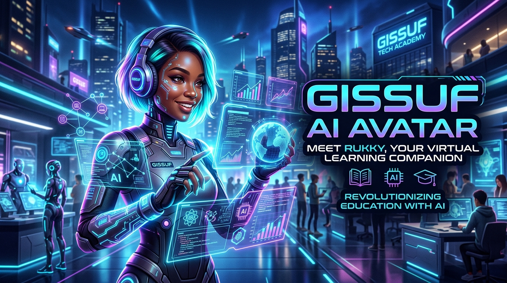

# GISSUF AI Avatar — Version 0.1
### Proprietary Virtual Human & Conversational AI Avatar Platform
**A GISSUF Technology Commercial Project**  
**Lead AI Persona:** Rukky (AI Student & Training Companion)  
**Repository:** [github.com/gissuf/gissuf-ai-avatar](https://github.com/gissuf/gissuf-ai-avatar)  

---



## 1. Project Vision

**GISSUF AI Avatar** is an independent, commercial conversational AI avatar platform developed by **GISSUF Technology**. The platform is designed to empower educational institutions, corporate enterprises, and individual professionals to deploy intelligent virtual humans capable of:

* Engaging in natural, real-time spoken and written conversations.
* Explaining complex technical and scientific concepts simply.
* Synchronizing visual facial expressions, mouth movements, and states.
* Participating directly in virtual classrooms and Zoom training meetings.
* Operating with zero external dependencies and ultra-low hardware requirements.

### First Character: Rukky
**Rukky** is our flagship virtual AI student. Designed as an intelligent, curious, and respectful learning companion, Rukky participates in artificial intelligence training classes, asks insightful questions, and collaborates with human students and instructors. Rukky is explicitly and ethically identified as an AI entity.

---

## 2. Key Features in Version 0.1

* **Lightweight Animated Avatar Engine:**
  - High-precision, scalable vector avatar for Rukky with multi-layer SVG & Canvas rendering.
  - Interactive state machine: `IDLE`, `LISTENING`, `THINKING`, `SPEAKING`, and `ERROR`.
  - Natural human-like blinking cycles and breathing mechanics.
  - Dynamic mouth viseme animations synced with speech output.
  - Real-time audio waveform HUD visualizer.
  - One-click **Stage View** for OBS Studio Virtual Camera capture.

* **Dual-Mode Dialogue System:**
  - **Curated Demonstration Mode (Default):** Zero cost, offline-capable knowledge base covering AI concepts, machine learning, neural networks, and GISSUF Technology.
  - **Live AI Model Mode (Optional):** Secure backend proxy supporting Google Gemini, OpenAI, or Groq API keys via a local `.env` file (API keys are never exposed to browser code).

* **Browser-Native Voice Interaction:**
  - **Speech-to-Text (STT):** Integrated Web Speech Recognition API with interim transcription preview and automatic speech-silence sending.
  - **Text-to-Speech (TTS):** Browser Speech Synthesis with automatic voice discovery, pitch/rate controls, and immediate speech-interrupt capability.

* **Optimized for Low-Resource Hardware:**
  - Engineered specifically for computers with **4 GB RAM and Intel Core i5 processors (e.g., i5-3337U)**.
  - Runs at 60 FPS with less than 25 MB RAM and zero dedicated GPU requirements.

* **Zoom Training Ready:**
  - Complete, production-tested workflow to broadcast Rukky as a live participant in Zoom meetings using OBS Virtual Camera and VB-CABLE audio routing.

---

## 3. Architecture Overview

```
+-----------------------------------------------------------------------------------+
|                        GISSUF AI AVATAR — ARCHITECTURE                            |
+-----------------------------------------------------------------------------------+
|                                                                                   |
|  +-----------------------------------+     +-----------------------------------+  |
|  |           USER BROWSER            |     |       PYTHON BACKEND SERVER       |  |
|  |  (Chrome, Edge, Chromium)         |     |          (server.py)              |  |
|  +-----------------------------------+     +-----------------------------------+  |
|  |  - Rukky Avatar Engine (SVG/HUD)  |     |  - Zero-dependency HTTP Host      |  |
|  |  - Web Speech STT (Microphone)    | <-> |  - GET /api/status                |  |
|  |  - Web Speech TTS (Voice Output)  |     |  - POST /api/chat                 |  |
|  |  - Dialogue Stream & Settings     |     |    * Demo Persona Knowledge Base  |  |
|  +-----------------------------------+     |    * Secure Live LLM Proxy (.env) |  |
|                   |                        +-----------------------------------+  |
|                   v                                          |                    |
|  +-----------------------------------+                       v                    |
|  |        ZOOM & MEETING OUTPUT      |     +-----------------------------------+  |
|  |  - OBS Virtual Camera (Video)     |     |   OPTIONAL CLOUD AI (Optional)    |  |
|  |  - VB-CABLE Virtual Audio (Voice) |     |   - Google Gemini / OpenAI / Groq |  |
|  +-----------------------------------+     +-----------------------------------+  |
+-----------------------------------------------------------------------------------+
```

---

## 4. Quick Start: Windows 10 Installation

### Method A: One-Click Launcher (Recommended)
1. Double-click the file **`run.bat`** in the project folder.
2. The application will start the server and open `http://localhost:8000` in your browser.

### Method B: Command Line (PowerShell)
```powershell
# Navigate to project directory
cd gissuf-ai-avatar

# Start the local server
python server.py 8000
```
Open your browser to `http://localhost:8000`.

---

## 5. Project File Structure

```text
gissuf-ai-avatar/
├── .env.example             # Optional API configuration template
├── .gitignore               # Git version control ignore rules
├── index.html               # Main frontend interface & HUD
├── run.bat                  # One-click Windows batch launcher
├── run.ps1                  # PowerShell launcher script
├── server.py                # Zero-dependency Python backend server
├── README.md                # Main project documentation
├── css/
│   └── style.css            # Cyber-clean responsive stylesheets & themes
├── js/
│   ├── app.js               # Application orchestrator
│   ├── avatar.js            # Rukky avatar state machine & animations
│   ├── chat.js              # Conversation stream manager
│   ├── settings.js          # Settings modal & local storage persistence
│   └── speech.js            # STT & TTS Web Speech controller
├── assets/                  # Branding graphics and visual assets
└── docs/
    ├── GITHUB_RESEARCH.md   # Open-source repository feasibility report
    ├── ROADMAP.md           # Commercial roadmap from v0.1 to v1.0
    ├── WINDOWS_SETUP_GUIDE.md # Beginner installation & troubleshooting guide
    └── ZOOM_INTEGRATION_GUIDE.md # OBS Virtual Camera & Zoom guide
```

---

## 6. Open-Source Research Summary

Prior to building Version 0.1, we conducted an in-depth evaluation of key open-source technologies:

* **TalkingHead (`met4citizen/talkinghead` - MIT):** 3D WebGL avatar engine. Selected as the target 3D engine for **Version 0.2**.
* **LiveKit Agents (`livekit/agents` - Apache 2.0):** Real-time WebRTC voice agent framework. Selected as the architectural blueprint for **Version 0.3+ Cloud/Enterprise tier**.
* **Zoom Meeting SDK (`zoom/meetingsdk-web`):** Evaluated for autonomous meeting attendance. Scheduled for **Version 0.4**.

*(See [`docs/GITHUB_RESEARCH.md`](docs/GITHUB_RESEARCH.md) for full analysis, hardware metrics, and commercial licensing guidelines.)*

---

## 7. Commercial Rights & Licensing

* **GISSUF AI Avatar Platform:** Copyright &copy; 2026 **GISSUF Technology**. All rights reserved.
* Third-party open-source components and browser specifications utilized in this project are governed by their respective permissive licenses (MIT, Apache 2.0, W3C Web Standards).
